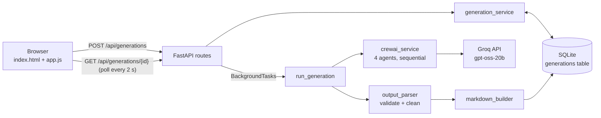

# CrewAI Multi-Agent Learning Assistant

A full-stack learning tool where **four CrewAI agents** work as a teaching team. You type a technical topic, and the agents produce a beginner-friendly explanation, three questions with grounded answers, a five-point summary, and a downloadable set of Markdown notes.

Built with **CrewAI + Groq (`groq/openai/gpt-oss-20b`)**, **FastAPI**, **SQLite / SQLAlchemy 2**, and a hand-written **HTML/CSS/JavaScript** frontend.

---

## Features

- **Four specialised agents** running in sequence: Learning Coordinator → Content Teacher → Q&A Specialist → Summary Writer.
- **Non-blocking generation**: the API returns a generation ID immediately and runs the agents in a background task; the page polls for status.
- **Honest progress**: a step is shown as finished only when CrewAI's `task_callback` reports that the agent's task completed.
- **Output validation**: exactly 3 questions, 3 answers and 5 summary points are enforced. If an agent breaks the format, the generation fails with a clear message instead of showing made-up or padded content.
- **Truncation detection**: the teacher ends with an `END_OF_EXPLANATION` marker; if it is missing, the user sees a warning that the explanation may be cut off.
- **History in SQLite**: every generation is saved and can be re-opened after a refresh or restart.
- **Copy and download**: copy any section, or download the full notes as a `.md` file.
- **Safe rendering**: generated Markdown is escaped first and then sanitized against an allowlist; a strict Content-Security-Policy blocks inline and third-party scripts.
- **Quota protection**: topic length limits, request-size limit, and a cap on concurrent generations.
- **Responsive UI**: checked at 1440, 1024, 768 and 390 px wide.

## Technology stack

| Layer | Technology |
|---|---|
| AI agents | CrewAI 1.15 (`crewai[litellm]`) |
| LLM | Groq, model `groq/openai/gpt-oss-20b` |
| API | FastAPI, Uvicorn, Pydantic v2 |
| Database | SQLite, SQLAlchemy 2.x |
| Frontend | HTML, CSS, vanilla JavaScript (no frameworks, no build step) |
| Tests | Pytest + FastAPI TestClient (backend), `node:test` (Markdown renderer) |

## Architecture



More diagrams are in [docs/ARCHITECTURE.md](docs/ARCHITECTURE.md).

## Screenshots

_Add your own screenshots here after running the app with your Groq key, for example:_

| Home | Generating | Results |
|---|---|---|
| `docs/screenshots/home.png` | `docs/screenshots/progress.png` | `docs/screenshots/results.png` |

## Quick start (Windows 11, PowerShell)

Requirements: **Python 3.12** (tested target 3.12.10) and a free Groq API key from <https://console.groq.com/keys>.

```powershell
cd crewai-learning-assistant
py -3.12 -m venv .venv
.\.venv\Scripts\Activate.ps1
python -m pip install --upgrade pip
pip install -r backend\requirements.txt
Copy-Item .env.example .env        # then open .env and paste your GROQ_API_KEY
cd backend
uvicorn app.main:app --reload
```

Open **<http://127.0.0.1:8000/app/>** in your browser. API docs are at <http://127.0.0.1:8000/docs>.

Git Bash users: activate with `source .venv/Scripts/activate` and copy with `cp .env.example .env`. Full instructions and troubleshooting: [docs/SETUP_AND_EXECUTION.md](docs/SETUP_AND_EXECUTION.md).

## API

| Method | Path | Purpose |
|---|---|---|
| GET | `/` | Welcome information and useful links |
| GET | `/health` | Database status and whether a Groq key is configured |
| POST | `/api/generations` | Submit a topic; returns `202` with a pending generation |
| GET | `/api/generations?limit=20` | History, newest first |
| GET | `/api/generations/{generation_id}` | Status, progress and results |
| GET | `/api/generations/{generation_id}/download` | Markdown notes as a file |

Examples, status codes and errors: [docs/API_REFERENCE.md](docs/API_REFERENCE.md).

## Folder structure

```text
crewai-learning-assistant/
├── backend/
│   ├── app/
│   │   ├── main.py                    # creates the FastAPI app, middleware, error handlers
│   │   ├── api/routes/
│   │   │   ├── system.py              # GET /  and  GET /health
│   │   │   └── generations.py         # the four /api/generations endpoints
│   │   ├── core/config.py             # settings from environment variables / .env
│   │   ├── database/
│   │   │   ├── database.py            # engine, sessions, init_db()
│   │   │   └── models.py              # the Generation table
│   │   ├── schemas/generation.py      # Pydantic request/response models
│   │   └── services/
│   │       ├── crewai_service.py      # the four agents and their tasks
│   │       ├── output_parser.py       # validates and cleans agent output
│   │       ├── markdown_builder.py    # builds the downloadable notes
│   │       └── generation_service.py  # DB helpers + the background job
│   ├── tests/                         # pytest suite (CrewAI is always mocked)
│   ├── pytest.ini
│   └── requirements.txt
├── frontend/
│   ├── index.html
│   ├── css/styles.css
│   ├── js/config.js  api.js  markdown.js  app.js
│   ├── assets/favicon.svg
│   └── tests/markdown.test.js
├── docs/                              # eight beginner-friendly guides
├── .env.example
├── .gitignore
└── README.md
```

## Testing

```powershell
cd backend
pytest
```

The tests never call Groq: an automatic fixture replaces the CrewAI pipeline with a guard that fails if anything tries to run it, and tests that need agent output use fakes. No API key is required.

Optional frontend renderer tests (Node.js 18+): `node --test frontend/tests/markdown.test.js` from the project root.

## Security notes

- `GROQ_API_KEY` is read only on the server, never logged, never returned by any endpoint, and excluded from Git by `.gitignore`.
- Topics are validated (2–120 characters, single line, no unknown fields); request bodies over 4 KB are rejected.
- Unexpected errors return a generic message; details go only to the server log.
- Generated content is rendered through an escape-first Markdown renderer plus an allowlist sanitizer, and pages under `/app` are served with a strict Content-Security-Policy.
- **Before deploying publicly**, add rate limiting per visitor, a spending cap or separate Groq key, and ideally a login. See [docs/SETUP_AND_EXECUTION.md](docs/SETUP_AND_EXECUTION.md#deploying-online).

## Known limitations

- Background jobs run inside the web server process. If the server stops while agents are working, that job is lost; on the next start it is marked **failed** with a clear message.
- SQLite suits a single server. Several server instances would need a shared database such as PostgreSQL.
- There is no user account system, so everyone using one server shares one history.

## Future improvements

- Per-user accounts and private histories.
- A persistent job queue so generations survive restarts.
- Streaming each agent's output to the page as it is written.
- Dark mode and printable PDF export.
- PostgreSQL for multi-instance deployments.

## Documentation

| Guide | What it covers |
|---|---|
| [PROJECT_OVERVIEW.md](docs/PROJECT_OVERVIEW.md) | What the project is, features, workflow |
| [ARCHITECTURE.md](docs/ARCHITECTURE.md) | How the pieces connect, with diagrams |
| [COMPLETE_BEGINNER_GUIDE.md](docs/COMPLETE_BEGINNER_GUIDE.md) | Every folder and concept from zero |
| [CODE_EXPLANATION.md](docs/CODE_EXPLANATION.md) | File-by-file walkthrough of the real code |
| [API_REFERENCE.md](docs/API_REFERENCE.md) | Every endpoint with examples |
| [SETUP_AND_EXECUTION.md](docs/SETUP_AND_EXECUTION.md) | Windows setup, running, testing, deployment |
| [INTERVIEW_PREPARATION.md](docs/INTERVIEW_PREPARATION.md) | Pitches and 35 interview Q&As |
| [LEARNING_ROADMAP.md](docs/LEARNING_ROADMAP.md) | The order to study this project in |
