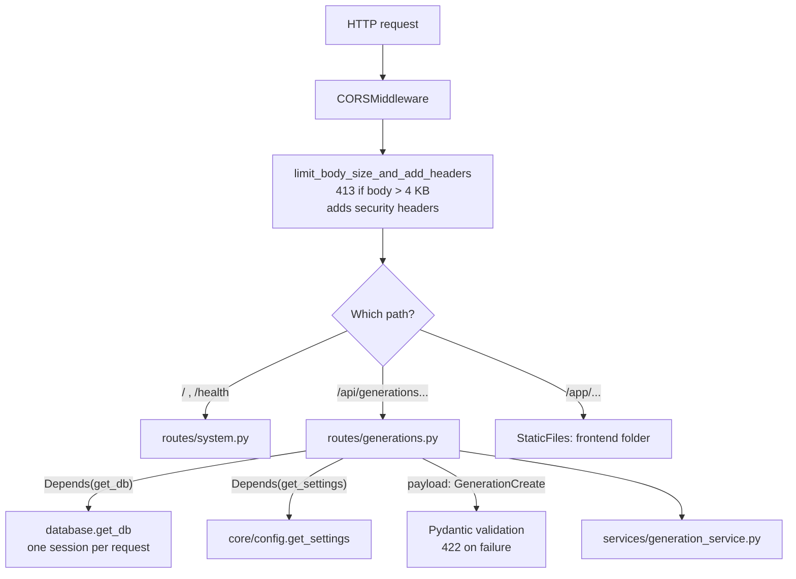
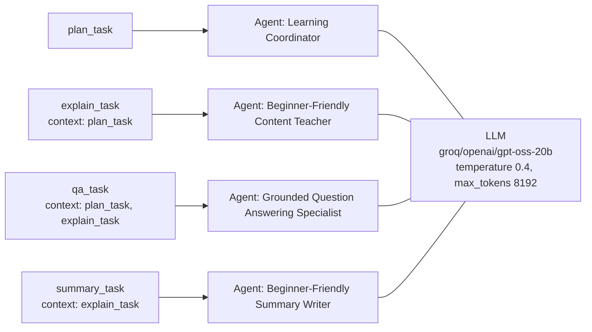
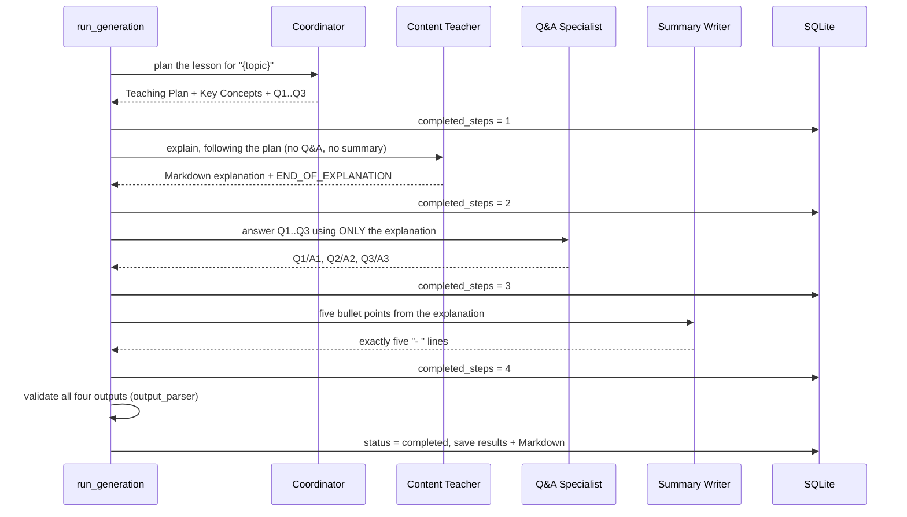
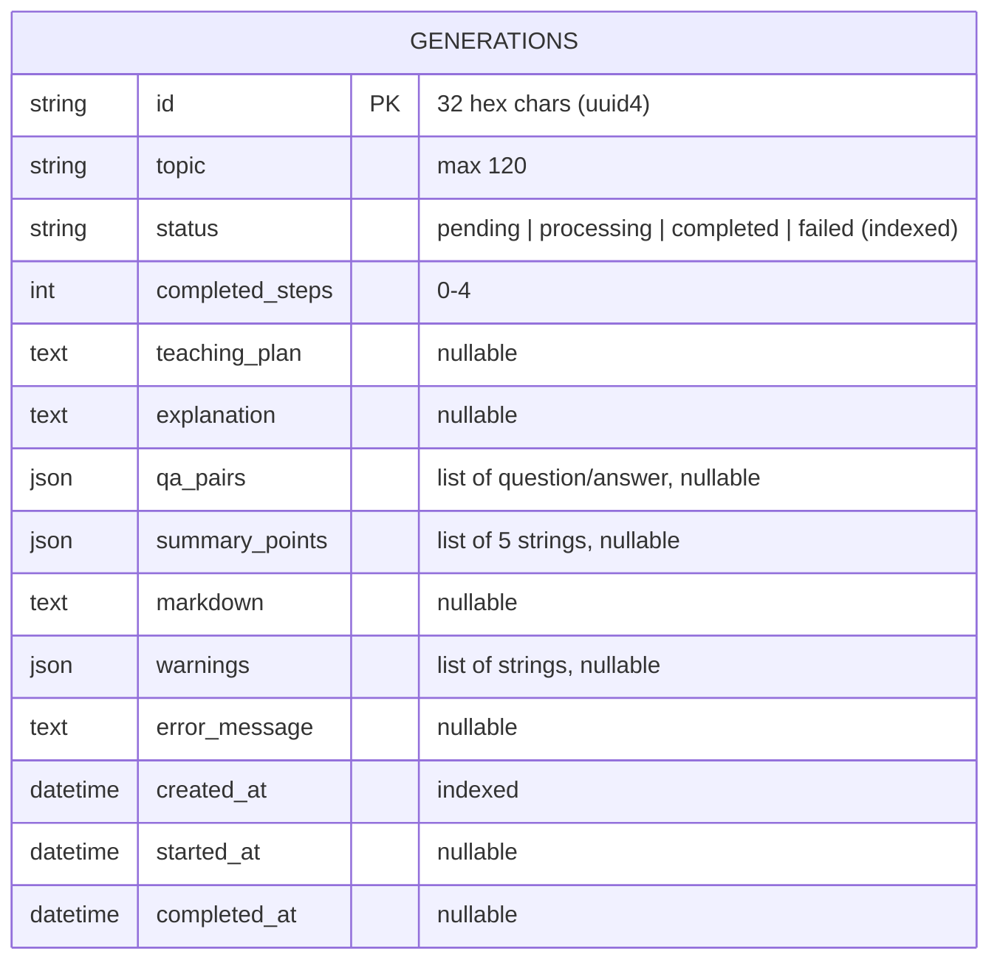
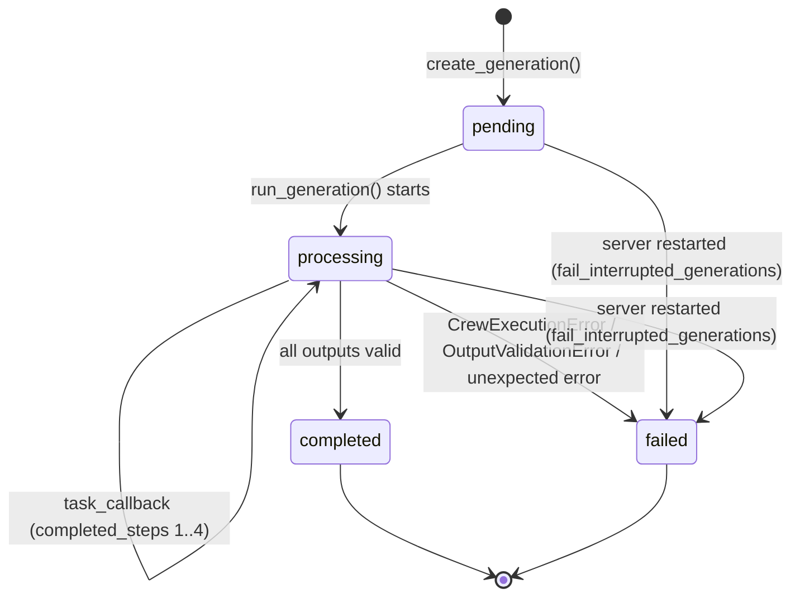

# Architecture

This document explains how the parts of the application fit together. Every name here (files, functions, endpoints) exists in the code.

## 1. The big picture

There are three running pieces:

1. **The browser** shows `frontend/index.html` and runs the JavaScript files.
2. **The FastAPI server** (`backend/app`) receives HTTP requests, stores data in SQLite, and runs the CrewAI agents in the background.
3. **The Groq API** (on the internet) runs the language model `openai/gpt-oss-20b` whenever an agent needs to "think".

The browser never talks to Groq directly, and never sees the API key. Only the server does.

## 2. Frontend ↔ backend communication

The frontend and backend talk using **HTTP requests with JSON bodies**.

| Browser function (`js/api.js`) | HTTP request | Backend function |
|---|---|---|
| `Api.health()` | `GET /health` | `system.health` |
| `Api.createGeneration(topic)` | `POST /api/generations` | `generations.submit_generation` |
| `Api.getGeneration(id)` | `GET /api/generations/{id}` | `generations.read_generation` |
| `Api.listGenerations(limit)` | `GET /api/generations?limit=…` | `generations.list_history` |
| `Api.downloadUrl(id)` (a link) | `GET /api/generations/{id}/download` | `generations.download_markdown` |

Where is the API? `js/config.js` decides:

- If the page was loaded from `/app/...`, the backend served it, so requests go to the **same origin** (`API_BASE_URL = ""`). No CORS is involved.
- Otherwise (e.g. Live Server on port 5500) requests go to `http://127.0.0.1:8000`, and the backend's **CORS** settings must list that page's origin (they do by default).

## 3. FastAPI architecture



Layers and their single responsibilities:

| Layer | Folder | Responsibility |
|---|---|---|
| Entry point | `app/main.py` | Builds the app: startup code, middleware, error handlers, routes, static files. |
| Routes | `app/api/routes/` | Translate HTTP into function calls and back. No business logic. |
| Schemas | `app/schemas/` | Pydantic models: what valid input and output look like. |
| Services | `app/services/` | The actual work: database helpers, running the crew, validating output, building Markdown. |
| Database | `app/database/` | Connection, sessions, and the table definition. |
| Config | `app/core/` | All settings in one immutable `Settings` object. |

## 4. CrewAI architecture

`services/crewai_service.py` builds one `Crew` containing four `Agent`s and four `Task`s, all sharing one `LLM` object.



Key settings:

- `process=Process.sequential`: tasks run one after another, in list order.
- `context=[...]`: CrewAI pastes the output of the listed tasks into the next agent's prompt. This is how the teacher sees the plan and the Q&A specialist sees the explanation.
- `allow_delegation=False`: agents cannot hand work to each other, so each does exactly its own job.
- `max_iter=3`: no tools are used, so an agent normally finishes in one model call; three is a safety limit.
- `task_callback`: called by CrewAI after each task finishes. We use it for progress.

## 5. The four-agent workflow



How the agents avoid repeating each other:

| Agent | Must do | Must not do |
|---|---|---|
| Coordinator | Plan + exactly three different questions | Explain the topic or answer the questions |
| Teacher | Full explanation with a worked example, `###` headings, end marker | Write questions, Q&A, summaries or recaps |
| Q&A Specialist | Answer the Coordinator's three questions from the explanation only | Use outside knowledge; guess when the explanation is silent |
| Summary Writer | Exactly five one-sentence bullets | Add titles, intros or new facts |

The prompts state these rules, and `output_parser.py` enforces the checkable ones in code.

## 6. Database architecture

One table is enough because there is one kind of thing to store: a generation.



- Tables are created automatically at startup by `init_db()` (`Base.metadata.create_all`).
- The database file is `backend/data/learning_assistant.db` by default.
- Q&A pairs and summary points are stored as JSON columns rather than separate tables, because they are always read together with their generation and never queried on their own.

## 7. Request–response flow: submitting a topic

```mermaid
sequenceDiagram
    participant B as Browser (app.js)
    participant F as FastAPI
    participant P as Pydantic
    participant G as generation_service
    participant DB as SQLite

    B->>F: POST /api/generations {"topic": " FastAPI "}
    F->>P: validate body as GenerationCreate
    P-->>F: topic = "FastAPI" (or 422 error)
    F->>F: GROQ key set? (else 503)
    F->>G: count_active_generations()
    G->>DB: SELECT count(*) WHERE status IN (pending, processing)
    F->>F: below MAX_ACTIVE_GENERATIONS? (else 429)
    F->>G: create_generation("FastAPI")
    G->>DB: INSERT row (status = pending)
    F->>F: background_tasks.add_task(run_generation, id)
    F-->>B: 202 Accepted {id, status: "pending", progress: 0/4}
    Note over F: response sent; now run_generation starts in a worker thread
    B->>B: location.hash = #/generation/{id}
    loop every 2 seconds
        B->>F: GET /api/generations/{id}
        F-->>B: status + progress (+ results when completed)
    end
```

## 8. Background generation lifecycle



**Why FastAPI `BackgroundTasks`?** It needs no extra software. After the response is sent, FastAPI runs `run_generation` in a worker thread (because it is a normal `def` function), so the server can keep answering status requests while the agents work.

**The important limitation.** Background tasks live in the memory of the server process. If you stop the server (Ctrl+C, a crash, a redeploy, or `--reload` restarting after you edit a file) while a job is running, that job disappears. The row would say "processing" forever, so on every startup `lifespan()` calls `fail_interrupted_generations()`, which marks such rows **failed** with the message *"The server restarted before this generation finished…"*. The user can then submit the topic again.

Other consequences of this simple design (all acceptable for a portfolio project):

- Jobs are not retried automatically.
- The concurrency cap (`MAX_ACTIVE_GENERATIONS`) is checked with a count followed by an insert, so two requests arriving at exactly the same moment could both pass. A real queue or a database lock would close that gap.
- Running several server processes would need a shared database and a real job queue (for example Celery with Redis, or a managed queue).

## 9. Error handling map

| What goes wrong | Where it is caught | What the user sees |
|---|---|---|
| Bad JSON, wrong type, empty or too-long topic | Pydantic + `handle_validation_error` | 422 with a field-specific message |
| Body over 4 KB | `limit_body_size_and_add_headers` | 413 |
| No `GROQ_API_KEY` | `submit_generation` | 503 and a banner on the page |
| Too many jobs running | `submit_generation` | 429 "Other generations are still running…" |
| Groq rate limit / bad key / timeout | `run_learning_crew` → `safe_error_message` | Generation **failed** with a friendly reason |
| Agent ignored the format | `output_parser` → `OutputValidationError` | Generation **failed** explaining which agent and why |
| Any other bug | `run_generation` last `except`, or `handle_unexpected_error` | Generic message; details only in the server log |
| Network loss while polling | `pollOnce` in `app.js` | Retries with back-off, then an explanation |
