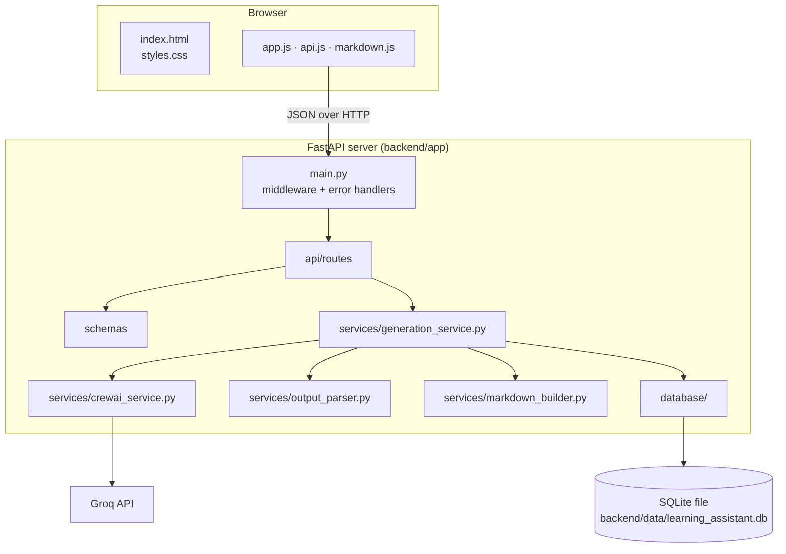

# Project Overview

## What this project is

The **CrewAI Multi-Agent Learning Assistant** is a website plus a backend API. You type the name of a technical topic, such as *FastAPI*, *SQL joins* or *Docker containers*, and a team of four AI agents writes learning notes about it for a complete beginner.

Instead of asking one large prompt to "explain X", the work is split between four agents, each with one clear responsibility. This mirrors how a real teaching team might work: someone plans the lesson, someone teaches it, someone checks understanding, and someone writes the recap.

## Why it is useful

- **For learners**: you get a structured, beginner-level explanation with a worked example, three self-check questions, and a short summary, all in one place and downloadable as Markdown for your own notes.
- **As a portfolio project**: it shows multi-agent design, a real REST API, background jobs, a database, input validation, safe rendering of AI output, testing without paid API calls, and a polished frontend, in a codebase small enough to explain fully in an interview.

## Main features

| Feature | How it works |
|---|---|
| Four-agent pipeline | CrewAI runs four tasks in order (sequential process). Later agents receive earlier agents' output as *context*. |
| Background generation | The API saves a "pending" row, returns its ID at once, and runs the agents after the response is sent (FastAPI `BackgroundTasks`). |
| Live, honest progress | CrewAI calls `task_callback` after each task. The backend stores the number of finished steps (0–4); the page shows only that. |
| Validation of AI output | `output_parser.py` checks for exactly 3 questions, 3 answers and 5 summary points. Wrong formats fail the job with a clear message. |
| Truncation warning | The teacher must end with `END_OF_EXPLANATION`. If the marker is missing, a visible warning says the text may be cut off. |
| History | Every generation is a row in SQLite, listed newest first on the home page. |
| Copy and download | Each section has a Copy button; the full notes download as `topic-name-learning-notes.md`. |
| Safety | Secrets stay on the server; input limits; escape-first Markdown rendering; Content-Security-Policy. |

## Technology stack

| Part | Technology | Why it was chosen |
|---|---|---|
| Language | Python 3.12 | Required by the brief; CrewAI supports Python 3.10–3.13. |
| Agents | CrewAI 1.15 with the `litellm` extra | CrewAI provides agents, tasks and sequential crews. In CrewAI 1.x, the `groq/...` model prefix is routed through LiteLLM, which is an optional extra. |
| LLM | Groq, `groq/openai/gpt-oss-20b` | Fast inference; model fixed by the brief. |
| API | FastAPI + Uvicorn | Automatic validation and documentation from type hints. |
| Validation | Pydantic v2 | Declares the exact request/response shapes. |
| Database | SQLite + SQLAlchemy 2 | A single file, no database server to install; SQLAlchemy is the standard Python ORM. |
| Frontend | HTML, CSS, vanilla JS | Nothing to compile; every line is readable by a beginner. |
| Tests | Pytest, FastAPI TestClient, Node's built-in test runner | The CrewAI step is replaced with fakes so tests are free and fast. |

## User workflow

1. Open `http://127.0.0.1:8000/app/`. The top bar shows whether the server is ready and has a Groq key.
2. Type a topic (or click an example) and press **Generate notes**.
3. The page switches to a progress view. Each agent's step is ticked as the server confirms it finished. You can leave; the job keeps running.
4. When all four agents finish and their output passes validation, the results view opens with four sections: **Topic explanation** (with the Coordinator's lesson plan), **Questions and answers**, **Five-point summary**, and **Complete learning notes**.
5. Copy a section, copy everything, or download the Markdown file.
6. Return to the home page; the topic is now in **Recent topics** and can be reopened at any time.

## Overall architecture

The backend also serves the frontend files at `/app`, so in development a single command runs the whole application. See [ARCHITECTURE.md](ARCHITECTURE.md) for the request flow and job lifecycle.
